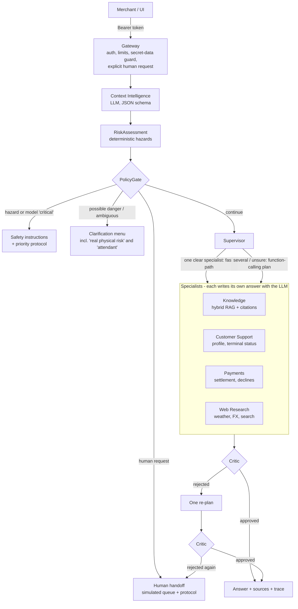

# Getnet Assist — multi-agent support for Getnet merchants

A FastAPI service in which LLM agents answer Getnet product, payment, terminal and public-information questions for merchants.

- Answers are built from real tools and retrieved evidence.
- An independent Critic reviews every automated answer and can reject it.
- Physical-risk reports, ambiguous messages and explicit requests for a person are handled by deterministic policies.
- The service hands off to a simulated human queue with a protocol number.

It runs with Docker Compose in two modes:

| Mode | When | Chat model | Embeddings | Request budget |
|---|---|---|---|---|
| **Cloud (default when a key is set)** | `GETNET_ANTHROPIC_API_KEY` in `.env` | Claude Haiku 5.5 (`claude-haiku-5-5`) | local `nomic-embed-text` | 30 s |
| **Offline (no key)** | `bash scripts/start-ai.sh -d` | local `qwen3:1.7b` on Ollama | local `nomic-embed-text` | 150 s |

Both modes run the same code through one provider layer (`backend/app/infra/llm/`). Every number below comes from a report file in `docs/`.

All customer records are **synthetic demo fixtures**. Nothing connects to real Getnet systems.

---

## Quick start

Requirements: Docker with Compose v2. The commands are for Linux and macOS.

```bash
git clone <this repository> getnet-assist && cd getnet-assist
cp .env.example .env
```

**Cloud mode.** Put your key in `.env` as `GETNET_ANTHROPIC_API_KEY=...`, then start the stack:

```bash
docker compose up -d --build
curl -s localhost:8000/api/health | python3 -m json.tool   # "llm_provider": {"provider": "anthropic", ...}
```

The key is read only from `GETNET_ANTHROPIC_API_KEY`, never from `ANTHROPIC_API_KEY`. It is passed to the SDK explicitly and never logged, traced, returned or stored; a test enforces this.

**Offline mode.** No key is needed. The first run downloads about 1.7 GB of models into the `ollama_data` volume.

```bash
bash scripts/start-ai.sh -d
curl -s localhost:8000/api/health | python3 -m json.tool   # "provider": "ollama", "model": "qwen3:1.7b"
```

Open <http://localhost:8080> and sign in with a listed demo account:

| User | PIN |
|---|---|
| `cliente1988` | `1988` |
| `demo-user-001` | `0001` |
| `demo-merchant-001` | `0002` |

The PINs are public on purpose because this is demonstration identity. With neither a key nor Ollama, the API still starts. In that case every answer is a labelled deterministic fallback (`degraded: true`).

Stop the stack with `docker compose down`. **Never add `-v`**: it would delete the model and data volumes.

### API in one call

```bash
TOKEN=$(curl -s -X POST localhost:8000/api/auth/demo-login -H 'Content-Type: application/json' \
  -d '{"user_id":"cliente1988","pin":"1988"}' | python3 -c 'import sys,json;print(json.load(sys.stdin)["access_token"])')
curl -s -X POST localhost:8000/api/chat -H "Authorization: Bearer $TOKEN" -H 'Content-Type: application/json' \
  -d '{"message":"Quando cai o dinheiro das vendas de ontem?","user_id":"cliente1988"}' | python3 -m json.tool
```

`POST /api/chat` takes `message` and `user_id`, as the challenge requires, plus an optional `session_id`. The identity comes from the bearer token. A body `user_id` that differs from the token returns 403, and a missing or invalid token returns 401.

The response contains:
- `answer`, `language`, `intent`, `agent`, `sources`;
- `trace`, `orchestration_mode`, `context_assessment`;
- `critic {approved, mode, issues}`;
- `specialist_observations`, `tool_calls`;
- `degraded` and `degraded_reason`;
- `model_usage` (calls, tokens, cost) and `stage_timings`;
- handoff fields when a protocol was created.

---

## Architecture



1. **Gateway.** It is deterministic.
   - It blocks passwords, tokens and card numbers before any model sees them.
   - An explicit request for a person goes straight to handoff.
2. **Context Intelligence** (`agents/context_intelligence.py`). One LLM call returns a compact JSON object validated by pydantic. The object holds intent, risk level, ambiguity, figurative language, recommended agents, action and confidence. Two general conservative floors apply:
   - a danger word with an explicit retraction becomes a clarification;
   - a danger word the model calls "safe" without a figurative reading also becomes a clarification.
3. **RiskAssessment** (`agents/risk_assessment_agent.py`). Regular expressions detect concrete hazards: fire, smoke, sparks, shock, swollen battery, overheating and burning smell. The model can never downgrade them.
4. **PolicyGate** (`agents/policy_gate.py`) decides in this order:
   1. a deterministic hazard raises an alert;
   2. a model "critical" without a deterministic hazard raises an alert;
   3. a model "potentially dangerous" or "ambiguous" shows a menu that offers "real physical risk" and "attendant";
   4. other uncertainty shows a topic menu;
   5. a human request creates a handoff;
   6. otherwise the turn continues.
5. **Supervisor** (`agents/supervisor_agent.py`) has two paths.
   - **Fast path:** when the Context Intelligence recommends exactly one routine specialist with confidence ≥ 0.75, the Supervisor dispatches to it with no extra model call.
   - **Planning loop:** otherwise, function calling chooses specialists for up to 3 rounds and 4 tools. A `FINAL` marker reuses the specialists' answers instead of generating a new one.
6. **Critic** (`agents/critic_agent.py`) checks every automated answer.
   - **Always, without a model:**
     - no request for a secret;
     - every `[n]` citation exists;
     - every ID, date, amount and status in the answer appears in the tool observations (`agents/grounding.py`).
   - **Then, with the model:** support, language, contradictions and unsafe guidance. It rejects only material problems.
   - A rejection triggers one re-plan. A second rejection hands off to a human.
7. **Request budget.** All model calls in one request share a deadline (`REQUEST_LLM_BUDGET_SECONDS`, default from the provider profile). When the budget is spent, the answer is a labelled deterministic fallback with `degraded: true`, not a 503.

### Agents and tools

| Agent | Responsibility | Tools / data | LLM calls |
|---|---|---|---|
| Context Intelligence | Interpret the turn with history (6 messages × 400 chars) | — | 1 (JSON schema) |
| RiskAssessment | Concrete physical hazards, also from history | regex over message and history | 0 |
| Supervisor | Fast path or planning loop; one re-plan after a Critic rejection | specialists exposed as tools | 0 on the fast path, 1–3 when planning |
| Knowledge | Getnet products, fees, Pix, receivables advance, crediário, Payment Link | hybrid RAG over the versioned corpus | 1 |
| Customer Support | Account profile and terminal status | `get_customer_profile`, `get_terminal_status` (SQLite) | 2: choose tools, then write |
| Payments | Settlement dates, sales, declined transactions | `lookup_payment_status`, `find_declined_transactions` (SQLite) | 2: choose tools, then write |
| Web Research | Weather, exchange rates, general public search | Open-Meteo, Frankfurter, DuckDuckGo (real HTTP) | 2: extract parameters, then write |
| Human Handoff | Protocol, queue, status, history, operator API | SQLite tickets | 0 |
| Critic | Deterministic checks, then model review | tool observations and evidence | 0–1 |

The tools never receive `user_id` from the model. Closures bind the authenticated server-side id, and a test proves that a model passing another customer's id still gets only the caller's data.

### RAG pipeline

1. **Ingestion.** `backend/app/knowledge/corpus.json` holds reviewed summaries of 10 official Getnet pages in PT and EN, for 26 chunks in total.
   - Startup never crawls the web.
   - An optional refresh (`docker compose --profile tools run --rm knowledge-refresh`) crawls only allowlisted Getnet hosts, for human review.
2. **Storage.** Text is chunked at 1,100 characters with 150 of overlap and keeps title, URL and language. Dense embeddings from `nomic-embed-text` are cached in SQLite.
3. **Retrieval.** BM25 over the language-matched corpus is combined with cosine similarity, returning top-4. When the best relevance is below 0.12, the agent abstains and the Supervisor shows a topic menu.
4. **Generation.** The model receives only the evidence, at most 500 characters per item and marked as untrusted data. It must cite `[n]`, answer in the customer's language and not guess fees or eligibility.
5. **Review.** The Critic checks that every citation exists and that the answer is supported. Without a model, the agent returns labelled extractive snippets (`degraded: true`).

### Fixed-text policy

Product, support, payment and research answers are always **written by an LLM agent** from tool or evidence data and reviewed by the Critic. Fixed text exists only for:

1. emergency and physical-risk instructions;
2. the sensitive-data block notice;
3. clarification menus (the options) and protocol confirmations;
4. explicit fallbacks when the model is disabled, unavailable or out of budget, always marked `degraded: true` and counted as failures by the benchmark.

The full inventory is in [docs/INVENTARIO_TEMPLATES.md](docs/INVENTARIO_TEMPLATES.md).

---

## Tests

```bash
cd backend && python3 -m venv .venv && . .venv/bin/activate && pip install -r requirements-dev.txt
PYTHONPATH=. OLLAMA_ENABLED=false python -m pytest -q        # no key, no internet, no model
cd ../frontend && npm ci && npx playwright install chromium
E2E_PYTHON=../backend/.venv/bin/python npm run test:e2e    # real UI + real API, scripted LLM
```

Each suite covers:

| Suite | What it proves |
|---|---|
| `test_agents_and_orchestration.py` | fast path vs planning loop; Supervisor uses the real specialists; Critic rejection → one re-plan → handoff; budget exhaustion → labelled fallback |
| `test_policy_and_datasets.py` | PolicyGate order; D3 menu with "real physical risk" and human; D4 subject change; decline error → Payments without an alert; zero safety false negatives; datasets disjoint; no 4-word dataset phrase in the routing code |
| `test_auth_and_isolation.py` | demo login, token tampering and expiry, 403 on a different `user_id`, A × B isolation (data, session, protocol, "show customer X's sales"), prompt injection in the message and inside a RAG document |
| `test_llm_providers.py` | adapter contracts without key or internet, provider selection, the key never appears in logs/responses/metrics/DB, no agent imports a provider client |
| `test_critic_agent.py`, `test_grounding.py` | the Critic rejects invented values, missing citations and requests for secrets, and approves grounded answers |
| `test_real_database_tools.py`, `test_real_knowledge_retrieval.py`, `test_web_research_tools.py` | real SQLite tools, real retrieval over the committed corpus, and web adapters (HTTP stubbed) |
| `frontend/e2e/support-flow.spec.ts` | login → product question → ambiguous menu → numeric selection → attendant → protocol status |

The browser test runs the API with `LLM_PROVIDER=fixture`. That scripted provider is selected only explicitly and reports itself in `/api/health`.

CI (`.github/workflows/build.yml`) runs:
- backend tests and the offline evaluation;
- `npm ci` and the frontend build;
- the Playwright flow;
- a Docker Compose smoke test (`docker compose down` without `-v`).

---

## Evaluation and observability

- **Context Intelligence datasets** ([backend/app/evaluation/DATASETS.md](backend/app/evaluation/DATASETS.md)):
  - `dev` (24 cases) was used during development;
  - `heldout` (44 new cases, including continuation, subject change, irony, prompt injection and contradiction) was written before the prompt rewrite and **never used for tuning**.
  - Run: `docker compose exec api python -m app.evaluation.run_context_eval --split heldout`.
- **End-to-end benchmark:** `python3 scripts/benchmark_latency.py --label <name> --rounds warm --warmup [--llm-down]`. It covers:
  - the 10 challenge questions, the dossier scenarios and the acceptance scenarios, with real HTTP and demo tokens;
  - each response classified as `llm_complete` or as a fallback or error;
  - latency computed over complete answers only;
  - route correctness, Critic rejections and escalations, degraded rate, LLM calls, tokens and cost per turn.
- **Per request.** `stage_timings` covers every stage (gateway, Context Intelligence, policy, Supervisor, each agent and tool, RAG, Critic, persistence). `model_usage` gives, for each call, its purpose, provider, model, tokens, latency and cost.
- **Aggregates.** `GET /api/metrics` gives tool calls and failures, stage timings and timeouts, and model calls, tokens and cost per provider and purpose.

---

## Measured results (2 Nov 2026)

Host: Intel i3 with 4 threads, 8 GB RAM and no GPU. Warm round with a pause between requests. Reports:
- Cloud benchmark: [RELATORIO_LATENCIA_2026-11-02_anthropic.json](docs/RELATORIO_LATENCIA_2026-11-02_anthropic.json). The earlier run, before the Critic calibration, is [anthropic-critic-v1](docs/RELATORIO_LATENCIA_2026-11-02_anthropic-critic-v1.json).
- Local benchmark: [RELATORIO_LATENCIA_2026-11-02_ollama.json](docs/RELATORIO_LATENCIA_2026-11-02_ollama.json).
- Context Intelligence evaluation: [docs/eval/](docs/eval/).
- Summary of both modes: [docs/RELATORIO_FINAL_2026-11-02.md](docs/RELATORIO_FINAL_2026-11-02.md).

| | Cloud — Claude Haiku 5.5 | Offline — Qwen3 1.7B (CPU) |
|---|---|---|
| **Context Intelligence, held-out (44, never tuned)**: risk / action / route accuracy | 90.9% / 88.6% / 90.5% | 77.3% / 40.9% / 4.8% |
| Held-out safety false negatives | **0** | **0** |
| Context Intelligence latency, mean (held-out) | 1.5 s | 14.8 s |
| **End-to-end, 17 latency requests**: complete by LLM / fallback | 17 / 0 | 16 / 1 |
| Route correct (challenge questions + D1/D2) | 12/12 | 2/12 (most went to a clarification menu) |
| Mean / p95 latency (complete answers) | 5.4 s / 15.3 s | 18.1 s / 65.3 s |
| Within target (simple ≤10 s, tools ≤15 s, complex ≤25 s) | 16/17 (one tools case at 15.3 s) | 11/16 (the fast "tools" cases mostly got a menu, not the tool) |
| Critic rejections → human escalations | 0/14 (first run before calibration: 3/14) | 0/3 |
| Cost per turn | US$ 0.00071 | US$ 0 |
| Acceptance scenarios run | all PASS (D9 runs in offline mode only) | FAIL: D2, A4, D4 (routing); D9 LLM down: PASS |

What these numbers mean:
- **Cloud mode** meets the routing and latency goals in this sample of 17 requests.
- **Offline Qwen 1.7B** is safe (no missed hazard) but over-asks for clarification. That is its real accuracy without dataset phrases in the code, and it is why the cloud mode is the demonstration mode.
- **Details:** every scenario, failure and trace is in [RELATORIO_FINAL_2026-11-02.md](docs/RELATORIO_FINAL_2026-11-02.md).

---

## Limitations

- **Synthetic data and simulated humans.** The customer records are fixtures, and no real operator is connected; responses state `real_agent_connected: false`. The operator API (`X-Operator-Key`) only demonstrates the workflow.
- **Demo identity.** PIN login with HMAC tokens binds the identity to the token, but it is not production authentication: the PINs are public, there is no rate limiting, and an empty `AUTH_SECRET` uses a per-process secret.
- **Small knowledge base.** It has 10 official pages and 26 chunks, so questions outside it get an abstention and a topic menu, not an answer.
- **Slow local CPU.** On this machine `qwen3:1.7b` prefills about 25 tokens/s and generates about 5 tokens/s. A full local turn takes tens of seconds, so the offline mode misses the latency targets. The cloud mode is the demonstration mode.
- **Model-dependent classification.** Context Intelligence accuracy depends on the model; see the held-out results. Concrete warning signs that the regex does not recognise, but the model rates "potentially dangerous", get the safety menu, not an immediate alert. The menu always offers "real physical risk".
- **Public data providers.** The weather, FX and search providers are unauthenticated public services and can rate-limit. The agent then says the provider is unavailable and never invents a value.

## Local vs cloud

| | Local (Ollama, Qwen3 1.7B) | Cloud (Claude Haiku 5.5) |
|---|---|---|
| Key / cost | none / US$ 0 | Anthropic key / ~US$ 0.0007 per turn (measured) |
| Data leaving the machine | none | the prompt (message, history, tool observations, evidence) goes to the Anthropic API |
| Latency on this host (measured mean) | 18 s, p95 65 s | 5.4 s, p95 15.3 s |
| Classification quality | lower (see held-out) | higher (see held-out) |
| Embeddings | local nomic | local nomic |

The default `LLM_PROVIDER=auto` uses the cloud when a key is present. `LLM_PROVIDER=ollama` (set by `scripts/start-ai.sh`) forces offline mode.

## Repository map

`backend/app/agents/` holds the agents, policy and grounding. `backend/app/infra/llm/` holds the provider layer. `backend/app/infra/database.py` holds SQLite (sessions, tickets, fixtures, audit). `backend/app/knowledge/` holds the corpus and ingestion. `backend/app/evaluation/` holds the datasets and runners. `frontend/` holds the React UI and Playwright test. `scripts/` holds the benchmark and the offline start script. `docs/` holds the architecture, audit and measurement reports.

See also [docs/ARCHITECTURE.md](docs/ARCHITECTURE.md), [docs/TESTING.md](docs/TESTING.md), [docs/SECURITY.md](docs/SECURITY.md) and [docs/AUDITORIA_V4.md](docs/AUDITORIA_V4.md).
