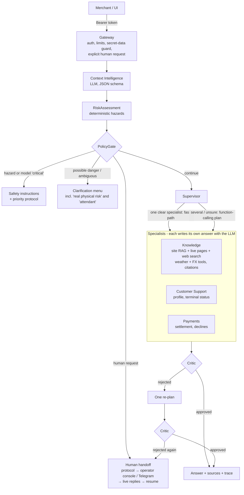

# Getnet Assist — multi-agent support for Getnet merchants

A FastAPI service in which LLM agents answer Getnet product, payment, terminal and public-information questions for merchants.

- Answers are built from real tools and retrieved evidence.
- An independent Critic reviews every automated answer and can reject it.
- Physical-risk reports, ambiguous messages and explicit requests for a person are handled by deterministic policies.
- The service hands off to human operators with a protocol number. Operators work in a web console or on Telegram, and the assistant resumes with what the human decided.

It runs with Docker Compose in two modes:

| Mode | When | Chat model | Embeddings | Request budget |
|---|---|---|---|---|
| **Cloud (default when a key is set)** | `GETNET_ANTHROPIC_API_KEY` in `.env` | Claude Haiku 5.5 (`claude-haiku-5-5`) | local `nomic-embed-text` | 30 s |
| **Offline (no key)** | `bash scripts/start-ai.sh -d` | local `qwen3:1.7b` on Ollama | local `nomic-embed-text` | 150 s |

Both modes run the same code through one provider layer (`backend/app/infra/llm/`). Every number below comes from a report file in `docs/`.

All customer records are **synthetic demo fixtures**. Nothing connects to real Getnet systems.

---

## For the evaluator (Para o avaliador)

The **main mode is the cloud** (Anthropic). **This project never distributes an API key.** You can check it in three ways:

| Way | What you need | What runs |
|---|---|---|
| Read the recorded cloud run | nothing | Committed cloud recordings: question, answer, sources, full trace, Critic verdict and tokens ([docs/EVIDENCE.md](docs/EVIDENCE.md)) |
| Replay | Docker or Python, no key | `LLM_PROVIDER=replay`: the recorded model answers are replayed. Retrieval, tools, PolicyGate and the Critic's deterministic checks run for real |
| Cloud mode with **your own** key | an Anthropic key | The steps below |

Credential policy, lockout and demo mode: [docs/SECURITY.md](docs/SECURITY.md).

Cloud mode with your own key:

1. `git clone https://github.com/Fredyycloss/desafio-getnet-multi-agente.git && cd desafio-getnet-multi-agente`
2. `bash scripts/set-api-key.sh`. The script:
   - asks for the key with hidden input and accepts only keys that start with the Anthropic prefix;
   - creates `.env` from `.env.example` if it does not exist;
   - writes only the `GETNET_ANTHROPIC_API_KEY` line, keeping every other line;
   - never prints the key.
3. `docker compose up -d --build`
4. `curl -s localhost:8000/api/health | python3 -m json.tool`. Expect:
   - `"llm_provider": {"provider": "anthropic", ...}`;
   - `"cloud_status": {"key_state": "ok", "message": "modo nuvem ativo"}`.

   If the key is refused (401/403) or the account has no credit, `cloud_status` says so, without showing the key. Answers are then marked `degraded: true` with `degraded_reason` = `llm_key_rejected`, `llm_key_forbidden` or `llm_no_credit`. To fall back to the local model instead, uncomment `LLM_FALLBACK_PROVIDER=ollama` in `.env`; see `.env.example`.
5. Open <http://localhost:8080> and sign in with a listed demo user: `cliente1988` / `1988`, `demo-user-001` / `0001` or `demo-merchant-001` / `0002`.

**Without a key**, the same code runs in offline mode with `bash scripts/start-ai.sh -d` (local Qwen3 1.7B, no cost). Measured results for both modes are in [docs/RELATORIO_FINAL_2026-11-02.md](docs/RELATORIO_FINAL_2026-11-02.md) and in [Measured results](#measured-results-2-nov-2026) below.

**Measured cost:** about **US$ 0.0007 per question** in cloud mode, averaged over the 17 benchmark questions (`mean_cost_usd_per_turn` = 0.000711). That is about 1,400 questions per US$ 1.

---

## Quick start

Requirements: Docker with Compose v2. The commands are for Linux and macOS.

```bash
git clone <this repository> getnet-assist && cd getnet-assist
cp .env.example .env
```

**Cloud mode.** Put your key in `.env` as `GETNET_ANTHROPIC_API_KEY=...`, then start the stack:

```bash
docker compose up -d --build
curl -s localhost:8000/api/health | python3 -m json.tool   # "llm_provider": {"provider": "anthropic", ...}
```

The key is read only from `GETNET_ANTHROPIC_API_KEY`, never from `ANTHROPIC_API_KEY`. It is passed to the SDK explicitly and never logged, traced, returned or stored; a test enforces this.

**Offline mode.** No key is needed. The first run downloads about 1.7 GB of models into the `ollama_data` volume.

```bash
bash scripts/start-ai.sh -d
curl -s localhost:8000/api/health | python3 -m json.tool   # "provider": "ollama", "model": "qwen3:1.7b"
```

Open <http://localhost:8080> and sign in with a listed demo account:

| User | PIN |
|---|---|
| `cliente1988` | `1988` |
| `demo-user-001` | `0001` |
| `demo-merchant-001` | `0002` |

The PINs are public on purpose because this is demonstration identity. With neither a key nor Ollama, the API still starts. In that case every answer is a labelled deterministic fallback (`degraded: true`).

Stop the stack with `docker compose down`. **Never add `-v`**: it would delete the model and data volumes.

### API in one call

The challenge payload, literally, without a token:

```bash
curl -s -X POST localhost:8000/api/chat -H 'Content-Type: application/json' \
  -d '{"message":"What is the difference between the Get Clássica and the Get Smart?","user_id":"cliente1988"}' | python3 -m json.tool
```

Without a token the turn is an **anonymous session**.
- Product questions (RAG), public information (weather, exchange rate, web) and human hand-off work normally.
- Tools with customer data never read anything from the body's `user_id`. They answer `login_required`, and the agent asks the customer to sign in.

With the demo login, the same endpoint reads the customer's own synthetic records:

```bash
TOKEN=$(curl -s -X POST localhost:8000/api/auth/demo-login -H 'Content-Type: application/json' \
  -d '{"user_id":"cliente1988","pin":"1988"}' | python3 -c 'import sys,json;print(json.load(sys.stdin)["access_token"])')
curl -s -X POST localhost:8000/api/chat -H "Authorization: Bearer $TOKEN" -H 'Content-Type: application/json' \
  -d '{"message":"Quando cai o dinheiro das vendas de ontem?","user_id":"cliente1988"}' | python3 -m json.tool
```

`POST /api/chat` request:
- **Required:** `message` and `user_id`, as the challenge requires.
- **Optional:** `session_id`, and `selected_topic` (sent by the home-screen suggestions: an explicit topic choice, answered without a clarification menu).

Identity and errors:
- With a token, the identity comes from the token, and a body `user_id` that differs from it returns 403.
- An invalid or expired token returns 401.
- The response field `authenticated` says which case applied.

The response contains:
- `answer`, `language`, `intent`, `agent`, `sources`;
- `trace`, `orchestration_mode`, `context_assessment`;
- `critic {approved, mode, issues}`;
- `specialist_observations`, `tool_calls`;
- `degraded` and `degraded_reason`;
- `model_usage` (calls, tokens, cost) and `stage_timings`;
- handoff fields when a protocol was created.

---

## Architecture



1. **Gateway.** It is deterministic.
   - It blocks passwords, tokens and card numbers before any model sees them.
   - An explicit request for a person goes straight to handoff.
2. **Context Intelligence** (`agents/context_intelligence.py`). One LLM call returns a compact JSON object validated by pydantic. The object holds intent, risk level, ambiguity, figurative language, recommended agents, action and confidence. Two general conservative floors apply:
   - a danger word with an explicit retraction becomes a clarification;
   - a danger word the model calls "safe" without a figurative reading also becomes a clarification.
3. **RiskAssessment** (`agents/risk_assessment_agent.py`). Regular expressions detect concrete hazards: fire, smoke, sparks, shock, swollen battery, overheating and burning smell. The model can never downgrade them.
4. **PolicyGate** (`agents/policy_gate.py`) decides in this order:
   1. a deterministic hazard raises an alert;
   2. a model "critical" without a deterministic hazard raises an alert;
   3. a model "potentially dangerous" or "ambiguous" shows a menu that offers "real physical risk" and "attendant";
   4. other uncertainty shows a topic menu;
   5. a human request creates a handoff;
   6. otherwise the turn continues.
5. **Supervisor** (`agents/supervisor_agent.py`) has two paths.
   - **Fast path:** when the Context Intelligence recommends exactly one routine specialist with confidence ≥ 0.75, the Supervisor dispatches to it with no extra model call.
   - **Planning loop:** otherwise, function calling chooses specialists for up to 3 rounds and 4 tools. A `FINAL` marker reuses the specialists' answers instead of generating a new one.
6. **Critic** (`agents/critic_agent.py`) checks every automated answer.
   - **Always, without a model:**
     - no request for a secret;
     - every `[n]` citation exists;
     - every ID, date, amount and status in the answer appears in the tool observations (`agents/grounding.py`).
   - **Then, with the model:** support, language, contradictions and unsafe guidance. It rejects only material problems.
   - A rejection triggers one re-plan. A second rejection hands off to a human.
7. **Request budget.** All model calls in one request share a deadline (`REQUEST_LLM_BUDGET_SECONDS`, default from the provider profile). When the budget is spent, the answer is a labelled deterministic fallback with `degraded: true`, not a 503.

### Agents and tools

| Agent | Responsibility | Tools / data | LLM calls |
|---|---|---|---|
| Context Intelligence | Interpret the turn with history (6 messages × 400 chars) | — | 1 (JSON schema) |
| RiskAssessment | Concrete physical hazards, also from history | regex over message and history | 0 |
| Supervisor | Fast path or planning loop; one re-plan after a Critic rejection | specialists exposed as tools | 0 on the fast path, 1–3 when planning |
| Knowledge | Getnet products, fees, Pix, receivables advance, crediário, Payment Link, and public questions | tools chosen by the LLM: `search_getnet_knowledge` (hybrid RAG over the site snapshot), `search_getnet_site_live`, `web_search` (Wikipedia/DDG Instant Answer, optional Brave key), `get_weather_forecast` (Open-Meteo), `get_exchange_rate` (Frankfurter) | 2: choose tools, then write |
| Customer Support | Account profile and terminal status | `get_customer_profile`, `get_terminal_status` (SQLite) | 2: choose tools, then write |
| Payments | Settlement dates, sales, declined transactions | `lookup_payment_status`, `find_declined_transactions` (SQLite) | 2: choose tools, then write |
| Human Handoff | Protocol, LLM summary for the operator, queue, live operator ↔ customer messages, resolution summary in history, hand-back to the AI with an instruction | SQLite tickets; web console `/operador` (individual logins); Telegram Bot API worker (buttons + replies) | 1 (operator summary) |
| Critic | Deterministic checks, then model review | tool observations and evidence | 0–1 |

The tools never receive `user_id` from the model. Closures bind the authenticated server-side id, and a test proves that a model passing another customer's id still gets only the caller's data.

### Knowledge base and RAG pipeline

1. **Ingestion: the whole official site.** Run `python -m app.knowledge.ingest_cli --render-js --embed`; see [ARCHITECTURE](docs/ARCHITECTURE.md#knowledge-base-and-knowledge-agent-tools).
   - **Discovery:** robots.txt → sitemaps → internal links, over `site.getnet.com.br` and `www.getnet.net` `/en` (the URL in the challenge) and `/pt`.
   - **Politeness:** ~1 s between requests, generic User-Agent, allowlist and HTTPS only.
   - **JavaScript pages:** rendered with Playwright Chromium.
   - **Not reached by sitemaps or links:** the official help pages are added as seeds.
   - **Snapshot 2026-11-03** ([manifest](backend/app/knowledge/snapshots/2026-11-03/manifest.json)):
     - 378 pages: 230 Getnet Brasil, 66 global English, 82 Getnet Portugal;
     - 52 pages rendered with JavaScript;
     - 757 chunks, 1.28 million characters;
     - 4,586 repeated menu, footer and banner blocks removed;
     - 13 fetch errors, listed with the reason.
   - **Boot:** reads the committed snapshot and never crawls.
   - **Previous base:** the 26 hand-written summaries of the previous version are kept only as an evaluation baseline.
2. **Storage.**
   - Chunks follow the page headings (merged when small, split with overlap when long).
   - Metadata: URL, title, section, breadcrumb, language, market (BR/PT/global), `fetched_at`, `content_hash`.
   - `nomic-embed-text` vectors are **precomputed** at ingestion and stored with the snapshot (float16, gzip), so no document is embedded at query time.
3. **Retrieval.**
   - **Scoring:** hybrid, 0.55 × BM25 + 0.45 × cosine. The BM25 part is normalised by the best score the question could reach, so relevance is absolute.
   - **Language:**
     - Portuguese questions down-weight the Portugal pages unless they ask about Portugal.
     - English questions also search the Portuguese-only Brazilian pages, with a small EN→PT glossary of domain terms for BM25.
   - **Abstention:** below relevance 0.35 (0.22 when the best page is in another language), the agent abstains. Both thresholds were calibrated on a separate set of 16 questions, not on the evaluation set.
4. **Generation.** The Knowledge Agent chooses its tools by function calling:
   - official-site RAG;
   - a live read of the official pages;
   - web search;
   - weather;
   - exchange rate.

   The LLM then writes only from the evidence and the tool results, with `[n]` citations pointing to the URL and section.
5. **Review.** The Critic checks citations, numbers, IDs and dates against the evidence and tool data. Without a model the agent returns labelled extractive snippets (`degraded: true`).

**Retrieval evaluation.** 70 questions in PT and EN: 60 answerable, labelled with the official URL that holds the answer, and 10 outside the base. Report: [RETRIEVAL_EVAL_2026-11-03.json](docs/eval/RETRIEVAL_EVAL_2026-11-03.json).

| Base / mode | Recall@1 | Recall@3 | Recall@5 | MRR | Correct abstention (outside the base) | Answers inside the base |
|---|---|---|---|---|---|---|
| Old: 26 hand-written summaries (BM25) | 33% | 38% | 40% | 0.36 | 100% | 20% |
| Snapshot, BM25 | 52% | 70% | 73% | 0.61 | 100% | 88% |
| Snapshot, dense only | 45% | 60% | 67% | 0.53 | 40% | 98% |
| **Snapshot, hybrid (default)** | **53%** | **70%** | **78%** | **0.62** | **100%** | **92%** |

### Fixed-text policy

Product, support, payment and research answers are always **written by an LLM agent** from tool or evidence data and reviewed by the Critic. Fixed text exists only for:

1. emergency and physical-risk instructions;
2. the sensitive-data block notice;
3. clarification menus (the options) and protocol confirmations;
4. explicit fallbacks when the model is disabled, unavailable or out of budget, always marked `degraded: true` and counted as failures by the benchmark.

The full inventory is in [docs/INVENTARIO_TEMPLATES.md](docs/INVENTARIO_TEMPLATES.md).

### Long conversations: session memory

The agents see only the last messages: Context Intelligence and Supervisor see 6.
- **When it starts.** Once a session passes `SESSION_SUMMARY_AFTER_MESSAGES` (default 12), the older messages are folded into a short summary written by the LLM. The update runs in the background after the response, so it adds no latency.
- **Facts.** The identifiers later turns refer to (terminal, transactions, attendance and action protocols, language) are extracted by code into structured session facts.
- **What the agents receive.** The facts and the summary in one memory message, followed by the last 5 messages.
- **Privacy.** E-mails, card numbers and credentials are redacted from the summary's input and output.
- **Scope.** The memory belongs to the session, which belongs to one customer.
- **Switch:** `SESSION_MEMORY=off`.
- **Tests:** `backend/tests/test_session_memory.py` (a 30-turn conversation, redaction, isolation).

### How the system improves over time

The model does not learn by itself. Improvement comes from a refreshed knowledge base, validated answers and human review.

1. **Refresh.** `knowledge-refresh` (see [Knowledge base](#knowledge-base-and-rag-pipeline)) re-crawls the official sites, reuses cached pages and embeddings by content hash, and writes a new versioned snapshot. To run it periodically, use a host cron line, for example `0 3 * * 1 docker compose --profile tools run --rm knowledge-refresh`.
2. **Feedback.** Each answer in the chat has 👍/👎 (`POST /api/feedback` with the `trace_id`). Only ids, the rating and a reason code are stored, never message text.
3. **Validated answers.** A Knowledge answer qualifies when all of these hold:
   - no customer data was used;
   - the model Critic approved it;
   - it has sources;
   - the customer rated it 👍.

   It is stored with its sources and the corpus version. A semantically equal question reuses it (trace `validated_answer_hit`, still reviewed by the Critic) until the corpus changes. A 👎 withdraws it.
4. **Knowledge gaps.** Abstentions, clarification menus, Critic rejections and 👎 enter a review queue: `GET /api/operator/knowledge-gaps`, with an operator token.
   - Any operator can dismiss a gap.
   - Only a supervisor can promote one:
     - to the knowledge base, with an answer and an official source URL, loaded at the next start;
     - or to the classifier examples, with a known intent.
   - Text that overlaps any evaluation dataset is refused (409). Every decision is audited.

Tests: `backend/tests/test_improvement_loop.py`.

---

## Tests

```bash
cd backend && python3 -m venv .venv && . .venv/bin/activate && pip install -r requirements-dev.txt
PYTHONPATH=. OLLAMA_ENABLED=false python -m pytest -q        # no key, no internet, no model
cd ../frontend && npm ci && npx playwright install chromium
E2E_PYTHON=../backend/.venv/bin/python npm run test:e2e    # real UI + real API, scripted LLM
```

Each suite covers:

| Suite | What it proves |
|---|---|
| `test_agents_and_orchestration.py` | fast path vs planning loop; Supervisor uses the real specialists; Critic rejection → one re-plan → handoff; budget exhaustion → labelled fallback |
| `test_policy_and_datasets.py` | PolicyGate order; D3 menu with "real physical risk" and human; D4 subject change; decline error → Payments without an alert; zero safety false negatives; datasets disjoint; no 4-word dataset phrase in the routing code |
| `test_auth_and_isolation.py` | demo login, token tampering and expiry, 403 on a different `user_id`, A × B isolation (data, session, protocol, "show customer X's sales"), prompt injection in the message and inside a RAG document |
| `test_llm_providers.py` | adapter contracts without key or internet, provider selection, the key never appears in logs/responses/metrics/DB, no agent imports a provider client |
| `test_critic_agent.py`, `test_grounding.py` | the Critic rejects invented values, missing citations and requests for secrets, and approves grounded answers |
| `test_real_database_tools.py`, `test_real_knowledge_retrieval.py`, `test_web_research_tools.py` | real SQLite tools, real retrieval over the committed corpus, and web adapters (HTTP stubbed) |
| `frontend/e2e/support-flow.spec.ts` | login → product question → ambiguous menu → numeric selection → attendant → protocol status |

The browser test runs the API with `LLM_PROVIDER=fixture`. That scripted provider is selected only explicitly and reports itself in `/api/health`.

CI (`.github/workflows/build.yml`) runs:
- backend tests and the offline evaluation;
- `npm ci` and the frontend build;
- the Playwright flow;
- a Docker Compose smoke test (`docker compose down` without `-v`).

---

## Evaluation and observability

- **Context Intelligence datasets** ([backend/app/evaluation/DATASETS.md](backend/app/evaluation/DATASETS.md)):
  - `dev` (24 cases) was used during development;
  - `heldout` (44 new cases, including continuation, subject change, irony, prompt injection and contradiction) was written before the prompt rewrite and **never used for tuning**.
  - Run: `docker compose exec api python -m app.evaluation.run_context_eval --split heldout`.
- **End-to-end benchmark:** `python3 scripts/benchmark_latency.py --label <name> --rounds warm --warmup [--llm-down]`. It covers:
  - the 10 challenge questions, the dossier scenarios and the acceptance scenarios, with real HTTP and demo tokens;
  - each response classified as `llm_complete` or as a fallback or error;
  - latency computed over complete answers only;
  - route correctness, Critic rejections and escalations, degraded rate, LLM calls, tokens and cost per turn.
- **Per request.** `stage_timings` covers every stage (gateway, Context Intelligence, policy, Supervisor, each agent and tool, RAG, Critic, persistence). `model_usage` gives, for each call, its purpose, provider, model, tokens, latency and cost.
- **Aggregates.** `GET /api/metrics` gives tool calls and failures, stage timings and timeouts, and model calls, tokens and cost per provider and purpose.

---

## Measured results (2 Nov 2026)

Host: Intel i3 with 4 threads, 8 GB RAM and no GPU. Warm round with a pause between requests. Reports:
- Cloud benchmark: [RELATORIO_LATENCIA_2026-11-02_anthropic.json](docs/RELATORIO_LATENCIA_2026-11-02_anthropic.json). The earlier run, before the Critic calibration, is [anthropic-critic-v1](docs/RELATORIO_LATENCIA_2026-11-02_anthropic-critic-v1.json).
- Local benchmark: [RELATORIO_LATENCIA_2026-11-02_ollama.json](docs/RELATORIO_LATENCIA_2026-11-02_ollama.json).
- Context Intelligence evaluation: [docs/eval/](docs/eval/).
- Summary of both modes: [docs/RELATORIO_FINAL_2026-11-02.md](docs/RELATORIO_FINAL_2026-11-02.md).

| | Cloud — Claude Haiku 5.5 | Offline — Qwen3 1.7B (CPU) |
|---|---|---|
| **Context Intelligence, held-out (44, never tuned)**: risk / action / route accuracy | 90.9% / 88.6% / 90.5% | 77.3% / 40.9% / 4.8% |
| Held-out safety false negatives | **0** | **0** |
| Context Intelligence latency, mean (held-out) | 1.5 s | 14.8 s |
| **End-to-end, 17 latency requests**: complete by LLM / fallback | 17 / 0 | 16 / 1 |
| Route correct (challenge questions + D1/D2) | 12/12 | 2/12 (most went to a clarification menu) |
| Mean / p95 latency (complete answers) | 5.4 s / 15.3 s | 18.1 s / 65.3 s |
| Within target (simple ≤10 s, tools ≤15 s, complex ≤25 s) | 16/17 (one tools case at 15.3 s) | 11/16 (the fast "tools" cases mostly got a menu, not the tool) |
| Critic rejections → human escalations | 0/14 (first run before calibration: 3/14) | 0/3 |
| Cost per turn | US$ 0.00071 | US$ 0 |
| Acceptance scenarios run | all PASS (D9 runs in offline mode only) | FAIL: D2, A4, D4 (routing); D9 LLM down: PASS |

What these numbers mean:
- **Cloud mode** meets the routing and latency goals in this sample of 17 requests.
- **Offline Qwen 1.7B** is safe (no missed hazard) but over-asks for clarification. That is its real accuracy without dataset phrases in the code, and it is why the cloud mode is the demonstration mode.
- **Details:** every scenario, failure and trace is in [RELATORIO_FINAL_2026-11-02.md](docs/RELATORIO_FINAL_2026-11-02.md).

---

### Offline Context Intelligence: embeddings vs Qwen vs hybrid

The hybrid mode (`CONTEXT_MODE=hybrid`) answers clear turns with a kNN over local `nomic-embed-text` embeddings of labelled examples (`backend/app/agents/intent_examples.json`, written from scratch). It calls Qwen on mandatory triggers:
- danger vocabulary;
- a figurative or retraction marker;
- possible injection;
- a short message that depends on the history;
- low confidence, margin or similarity.

Thresholds were fixed before measuring. Each mode was measured once on the held-out set (44 cases).

| Mode | Risk | Action | Route | Safety false negatives | Qwen calls | Mean latency |
|---|---|---|---|---|---|---|
| A — embeddings only | 86.4% | 56.8% | 42.9% | **23.1%** | 0% | 0.1 s |
| **B — Qwen only (offline default)** | 77.3% | 40.9% | 4.8% | **0%** | 100% | 14.8 s |
| C — hybrid | 77.3% | 59.1% | 47.6% | **7.7%** | 66% | 10.5 s |

**Decision.** The rule was that hybrid replaces Qwen-only only if it adds no safety false negatives. It did not pass. C is better on action, route and latency, but it missed one dangerous case that B catches: "the terminal charger is too hot to hold", which the kNN matched to terminal support.

- **Offline default:** `CONTEXT_MODE=llm` (B).
- **Hybrid:** available behind the flag.
- **Embeddings only (A):** rejected.
- **No post-hoc tuning:** adding trigger words for this case after seeing it would be tuning on the held-out set.

## Limitations

- **Synthetic data.** The customer records are fixtures. Human operators are real people using the console or Telegram. `real_agent_connected` is `true` only while a channel is live, so with nobody online the customer is told the request is waiting. See [docs/HITL.md](docs/HITL.md).
- **Demo identity.** PIN login with HMAC tokens binds the identity to the token, but it is not production authentication: the PINs are public, there is no rate limiting, and an empty `AUTH_SECRET` uses a per-process secret.
- **Knowledge base scope.** It covers the official sites as of the snapshot date (378 pages). The help-centre FAQ widget (`/duvidas/*`) is a JavaScript chatbot with little indexable text. Answers can be as stale as the last `knowledge-refresh`.
- **Slow local CPU.** On this machine `qwen3:1.7b` prefills about 25 tokens/s and generates about 5 tokens/s. A full local turn takes tens of seconds, so the offline mode misses the latency targets. The cloud mode is the demonstration mode.
- **Model-dependent classification.** Context Intelligence accuracy depends on the model; see the held-out results. Concrete warning signs that the regex does not recognise, but the model rates "potentially dangerous", get the safety menu, not an immediate alert. The menu always offers "real physical risk".
- **Public data providers.** The weather, FX and search providers are unauthenticated public services and can rate-limit. The agent then says the provider is unavailable and never invents a value.

## Local vs cloud

| | Local (Ollama, Qwen3 1.7B) | Cloud (Claude Haiku 5.5) |
|---|---|---|
| Key / cost | none / US$ 0 | Anthropic key / ~US$ 0.0007 per turn (measured) |
| Data leaving the machine | none | the prompt (message, history, tool observations, evidence) goes to the Anthropic API |
| Latency on this host (measured mean) | 18 s, p95 65 s | 5.4 s, p95 15.3 s |
| Classification quality | lower (see held-out) | higher (see held-out) |
| Embeddings | local nomic | local nomic |

The default `LLM_PROVIDER=auto` uses the cloud when a key is present. `LLM_PROVIDER=ollama` (set by `scripts/start-ai.sh`) forces offline mode.

## Repository map

`backend/app/agents/` holds the agents, policy and grounding. `backend/app/infra/llm/` holds the provider layer. `backend/app/infra/database.py` holds SQLite (sessions, tickets, fixtures, audit). `backend/app/knowledge/` holds the corpus and ingestion. `backend/app/evaluation/` holds the datasets and runners. `frontend/` holds the React UI and Playwright test. `scripts/` holds the benchmark and the offline start script. `docs/` holds the architecture, audit and measurement reports.

See also [docs/ARCHITECTURE.md](docs/ARCHITECTURE.md), [docs/TESTING.md](docs/TESTING.md), [docs/SECURITY.md](docs/SECURITY.md) and [docs/AUDITORIA_V4.md](docs/AUDITORIA_V4.md).
