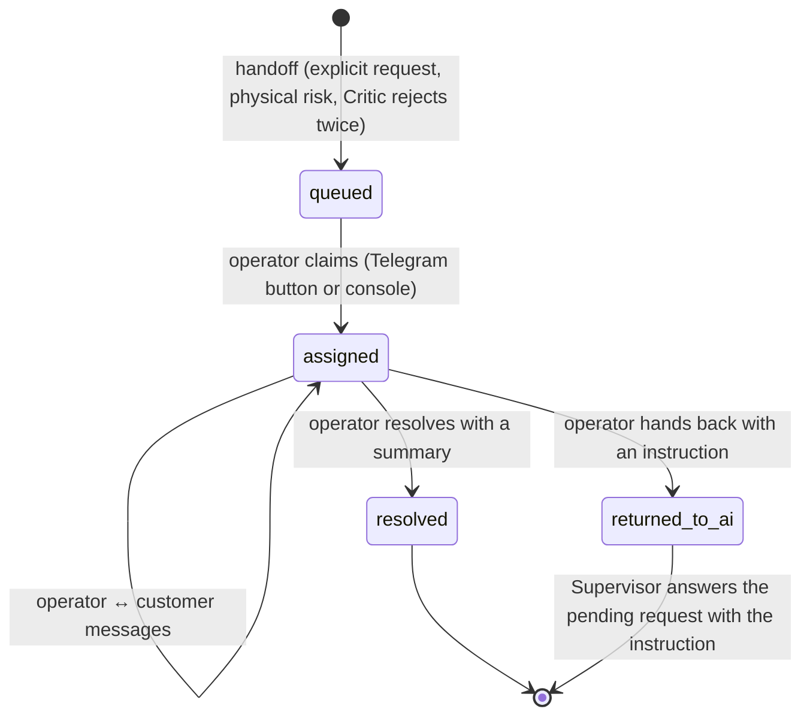

# Human in the loop: operators, channels and resumption

## Lifecycle



### Customer view

| Status | Label in the chat | What the customer sees |
|---|---|---|
| `queued` | aguardando atendente | The assistant keeps answering. The UI polls `GET /api/sessions/{id}/messages?after_id=N` every 3 s. |
| `assigned` | em atendimento | Every customer message goes to the ticket, not to the agents. Operator messages appear live with the label **Atendente** and the operator's name. |
| `resolved` | resolvido | The resolution summary is written into the session history. The next AI answer takes the human decision into account (for example, "the technician is booked for tomorrow"). |
| `returned_to_ai` | resolvido (de volta ao assistente) | The operator's instruction is stored as a hidden history note, visible to the agents and not to the customer. The Supervisor answers the customer's pending request immediately (console) or at the next poll (Telegram), with the trace starting `resumed_after_human_handoff`. |

### `real_agent_connected`

It is `true` only when a real channel is live: the Telegram worker heartbeat, or an operator console session active in the last 90 s.

## Channels

### Telegram

Requirements: a bot and an operators' group. The worker uses long polling (`getUpdates`), so no public URL is needed.

**Setup:**

1. In Telegram, talk to **@BotFather** → `/newbot` → choose a name and a username. BotFather returns the **token**.
2. Create a group for the operators, add the bot and send any message in the group.
3. Put the values in `.env`. They are never committed or logged.
   ```
   TELEGRAM_BOT_TOKEN=<token from BotFather>
   TELEGRAM_OPERATOR_CHAT_ID=<group id, negative number>
   TELEGRAM_OPERATOR_IDS=<comma-separated Telegram user ids allowed to act>
   ```
   To find the group id, open `https://api.telegram.org/bot<token>/getUpdates` after step 2 and read `message.chat.id`. Your own user id is `message.from.id`.
4. Start the worker: `docker compose up -d telegram-worker`. It is a single instance. Without a token it idles and logs that it is not configured.

**Operator actions in the group:**

| Action | How |
|---|---|
| New handoff | A card arrives with protocol, priority, reason and an LLM summary without sensitive data, plus the buttons **Assumir / Responder / Resolver**. |
| Talk to the customer | Reply to the card (or to any forwarded customer message), or send `/r <protocol> <text>`. Replying to a queued ticket claims it. |
| Resolve | `/resolve <protocol> <summary>` |
| Hand back to the AI | `/ai <protocol> <instruction>`, for example "cliente validado, siga com a consulta de vendas de ontem". |

**Authorization and audit.** Only user ids in `TELEGRAM_OPERATOR_IDS` can act. Anyone else gets "Operador não autorizado", and the attempt is audited. Every action goes to `operator_audit` (who, channel, action, protocol, outcome).

**Telegram outage.** The ticket stays in the queue and the web console keeps working. Tested in `test_telegram_outage_keeps_the_ticket_queued_for_the_console`.

### Web console: `http://localhost:8080/operador`

**Login.** Each operator signs in with an individual account: a scrypt password hash and the role `operator` or `supervisor`.
- **Demo:** with `DEMO_MODE=true` there are two synthetic accounts, `ana.operadora` / `demo-ana-2026` (operator) and `bruno.supervisor` / `demo-bruno-2026` (supervisor).
- **Production:** create accounts with `docker compose exec api python -m app.hitl.operators add <user> --role operator`.

**What it shows.** The queue (waiting and in progress, by severity), the ticket details with history and summary, and the actions **Assumir, Responder, Resolver, Devolver para a IA**.

**API:**
- `/api/operator/login`, `/queue`, `/tickets/{protocol}`;
- `/tickets/{protocol}/claim | messages | resolve | return-to-ai`;
- `/audit` (supervisor only), `/channels`.

## Tests

| Test | What it covers |
|---|---|
| `backend/tests/test_hitl_telegram.py` | Simulated Bot API transport: card + buttons, claim callback, reply to the card, `/r`, `/resolve`, `/ai`, unauthorized user, Telegram outage, customer message forwarded (redacted), the token never in calls or repr |
| `backend/tests/test_hitl_api.py` | End to end through the API: handoff → operator login → claim → reply visible to the customer → customer message goes to the ticket → resolution in history → next AI turn; return to the AI → the Supervisor resumes |
| `frontend/e2e/hitl-flow.spec.ts` | Playwright with two pages, customer and operator console |

## Evidence

`docs/evidence/hitl/` holds:
- a transcript of a real handoff (customer → Telegram operator → resolution → AI resuming);
- Telegram screenshots;
- the matching trace.

It is produced once the bot token is configured.
